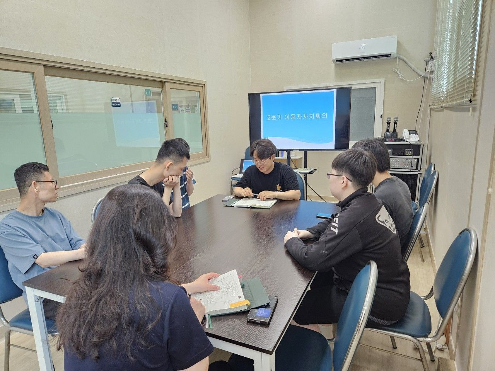
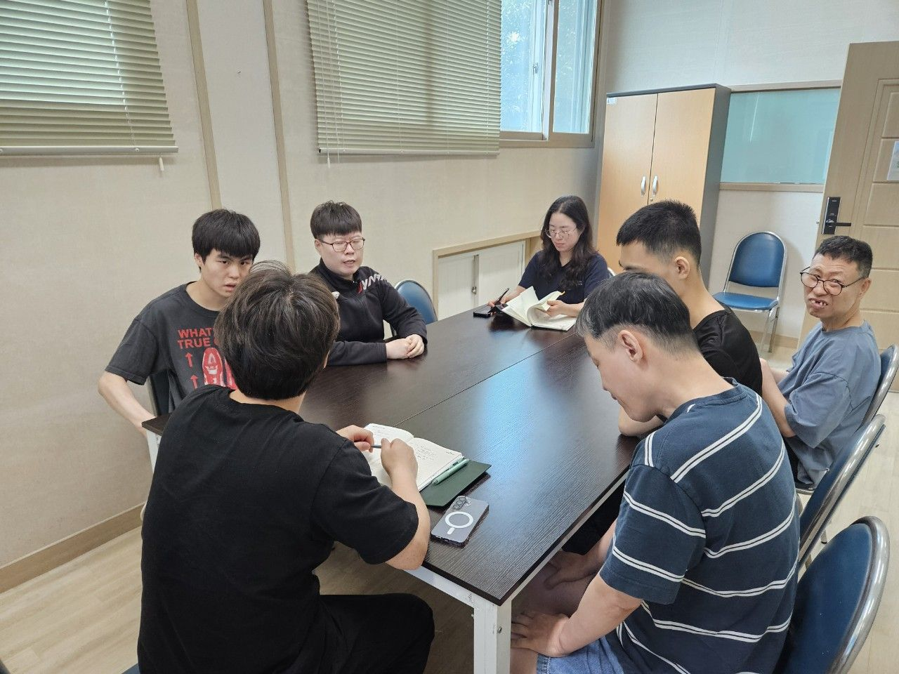

6월 29일 2분기 이용자자치회의를 진행하였습니다. 

세종빌 프로그램 일정들을 공유하고 시설생활 전반에 있어 

이용자분들께서 겪는 불편사항, 개선 사항,욕구 사항들을 의논하며

즐거운 세종빌 생활이 될 수 있도록 지원하여 드릴 수 있는 시간을 가져보았습니다.

 

* 2분기 자치회의 결과 

 

가. 여름캠프 및 이벤트프로그램 공지

- 캠프 장소 및 일정 공유, 방별 바베큐 파티 일정 공유 

 

나. 방별 가족간담회 상정 안건

- 없음. 

 

다. 시설운영에 바라는 점등 기타안건

- 생활실 운영 지원(방별 화장실 악취&lt;소변&gt; 호소 : 회의를 통한 해결방안 마련) 

- 여가활동 지원(찜질방, 코인 노래방지원)

- 식당 메뉴 욕구 반영(복날 메뉴 : 초계국수, 닭칼국수 메뉴 반영, 하이라스 메뉴 반영)

- 필요물품 지원(시설 주변 산책시 밀짚모자 구입 지원)

 

*  9월 3분기 이용자자치회의 개최 예정.

 

 

 

 

   

