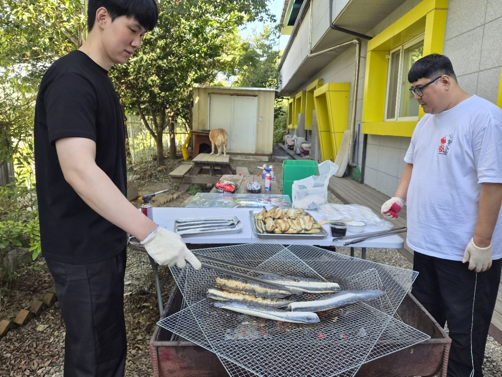
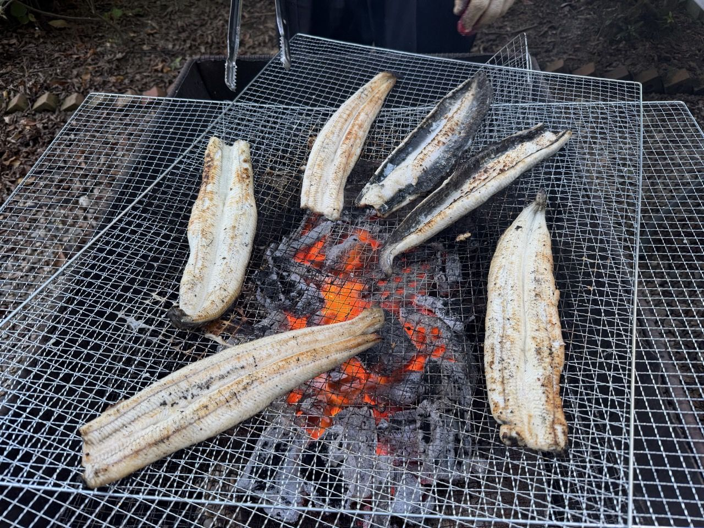
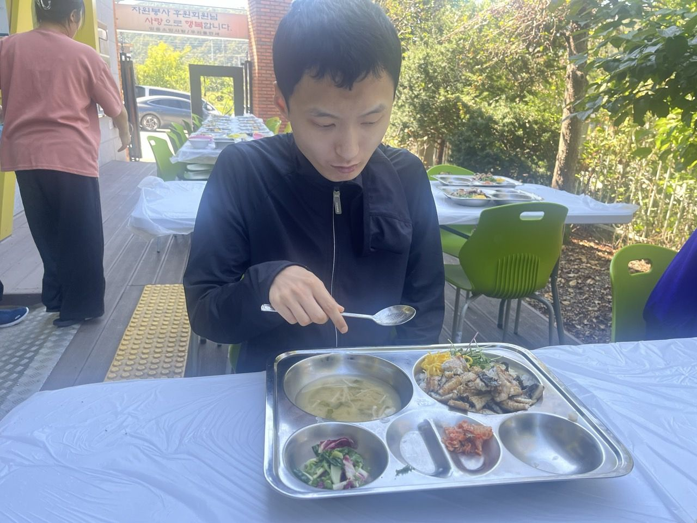
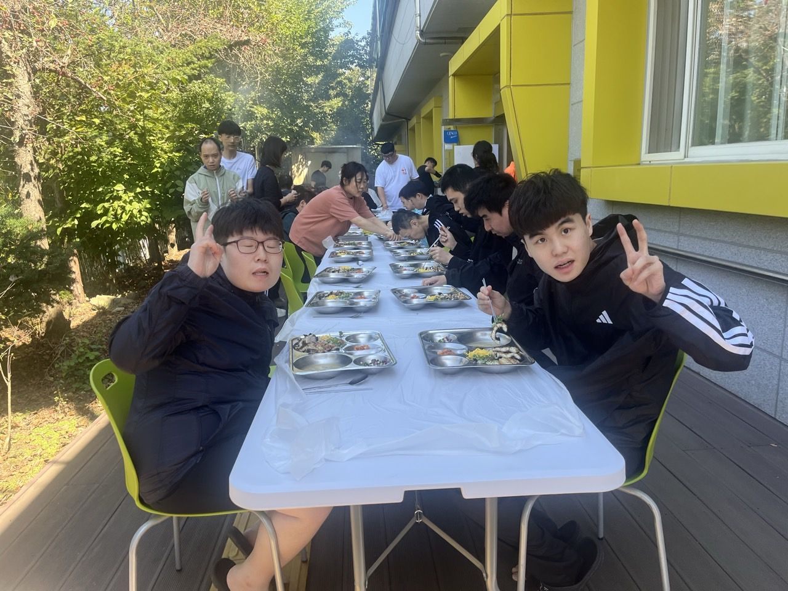
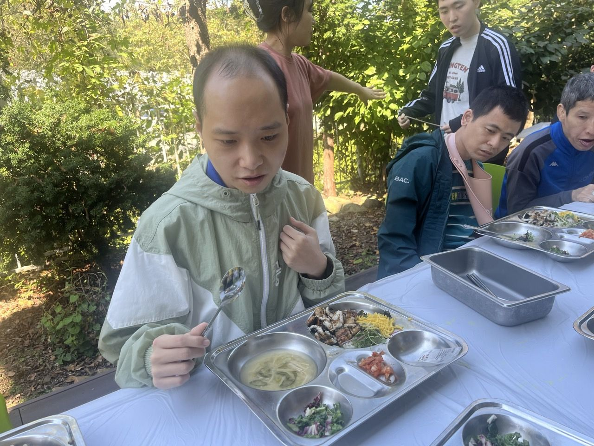
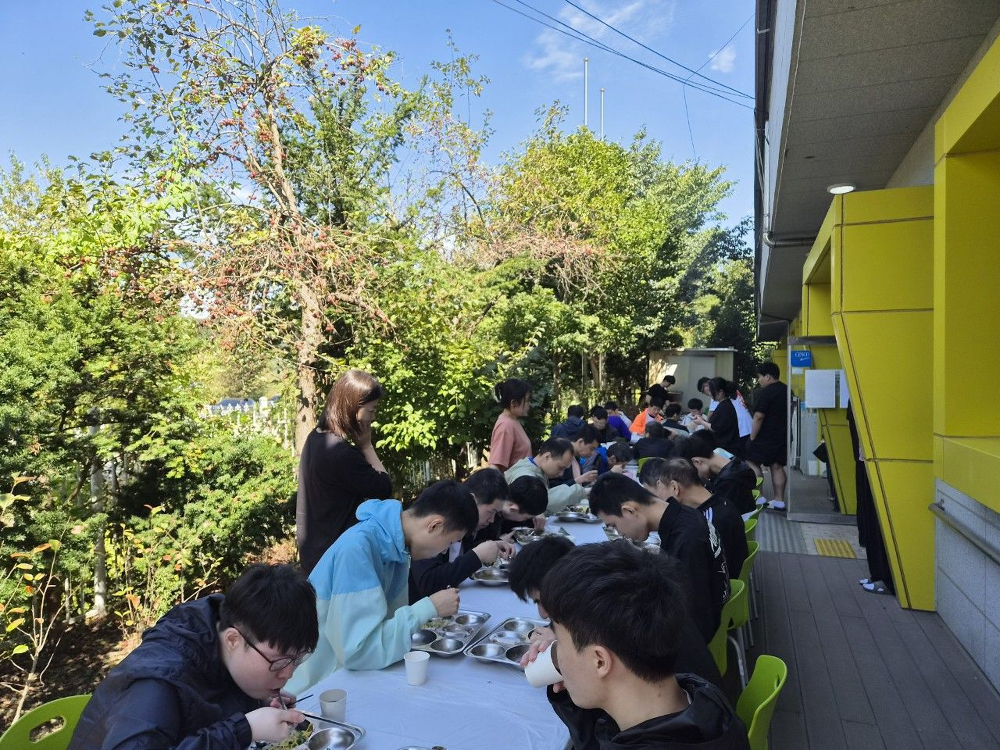

무더위가 물러가고 선선한 가을 바람이 불어 기분 좋은 날씨지만 이런 날씨일수록 건강관리가 중요하기에 이용자 분들에게 건강관리를 위한 몸보신을 준비하였습니다.

숯불 장어덮밥인데요, 마당에서 직접 숯을 피워 정성스럽게 장어를 노릇노릇 구워 양념까지 입혀 정말 먹음직 스러웠답니다.

장어덮밥 한그릇씩 드시고 건강하게 환절기를 이겼으면 좋겠어요.

          

