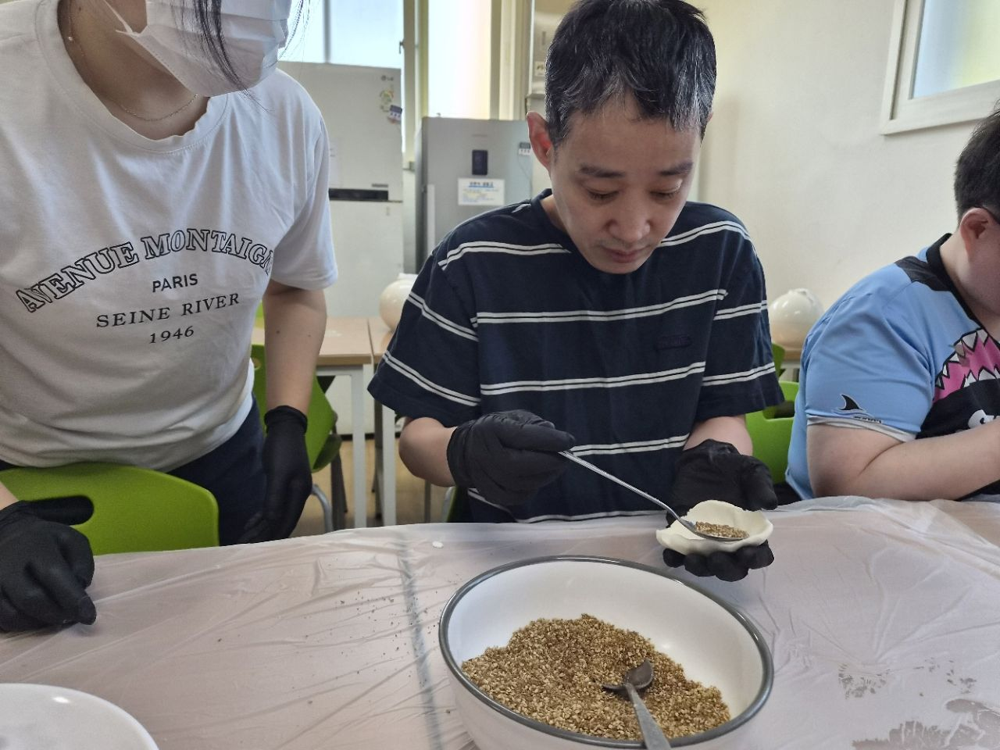
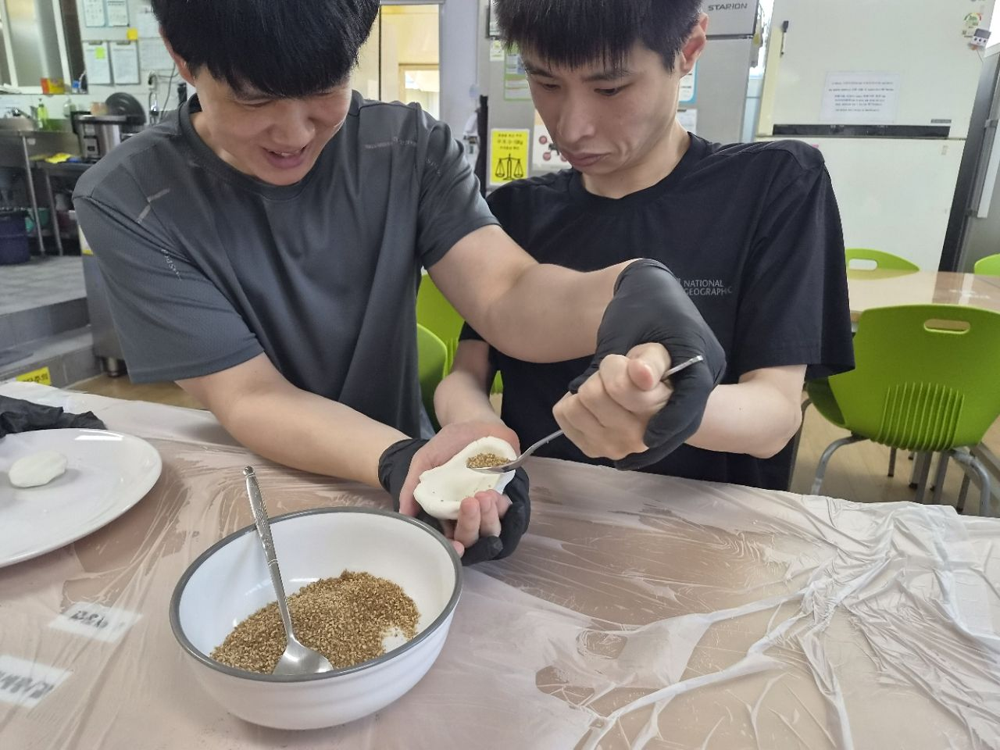
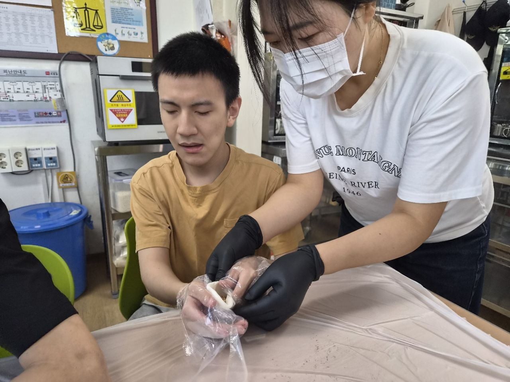
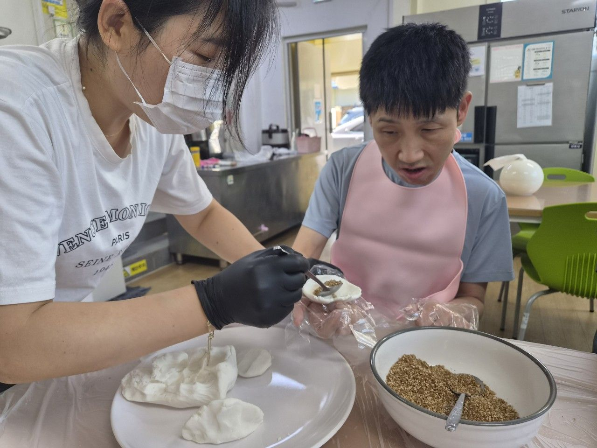
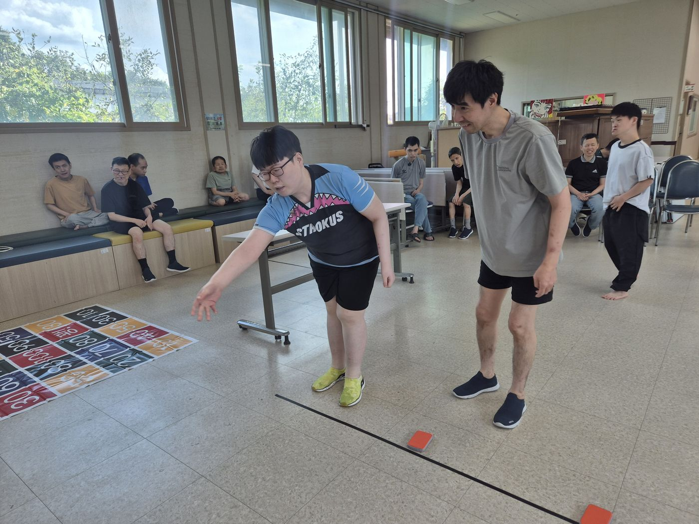
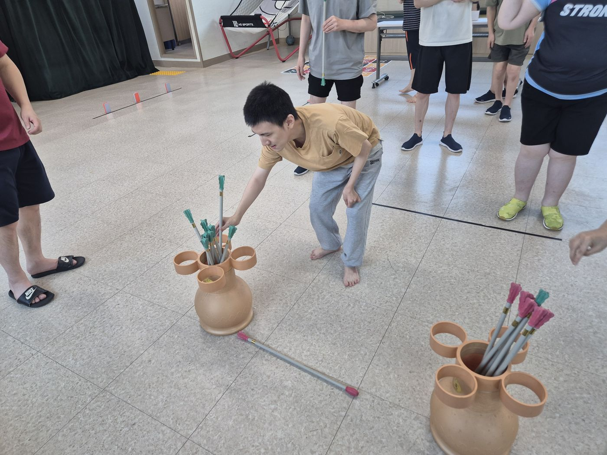
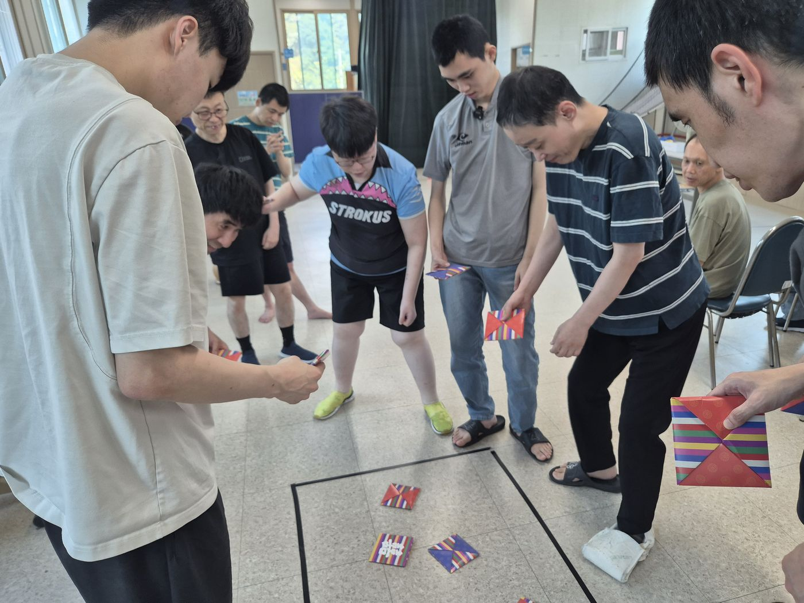
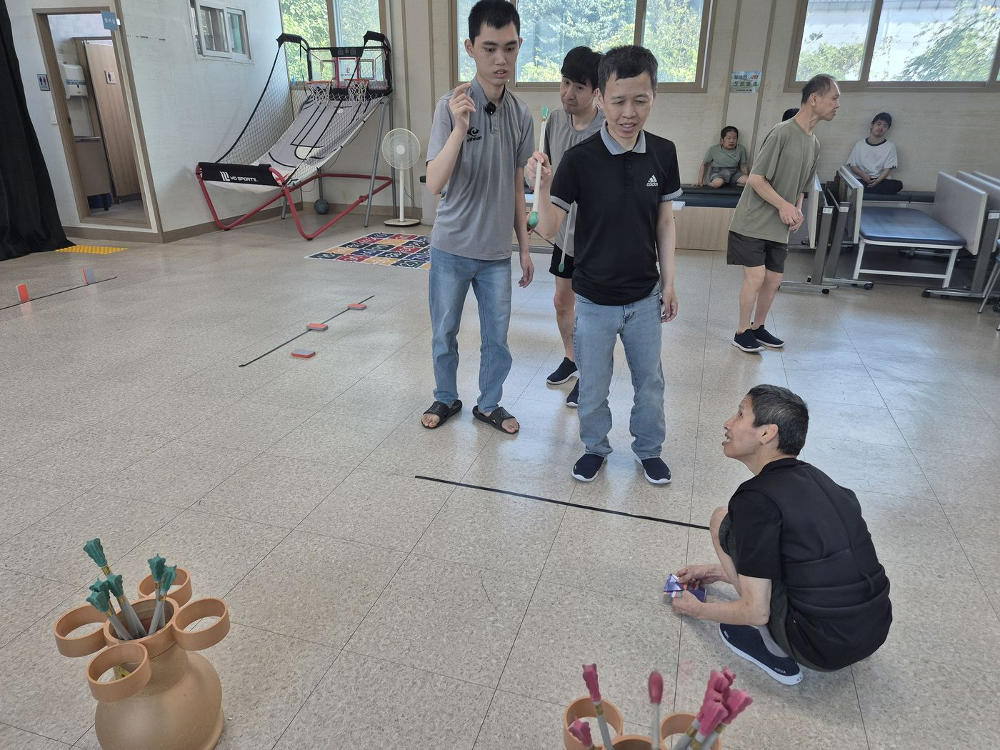
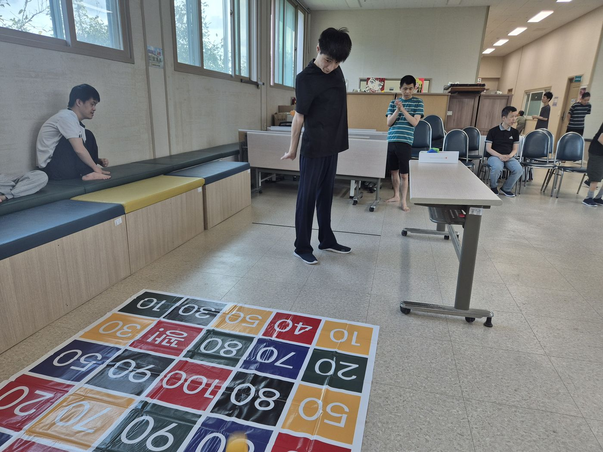

★ 풍성한 한가위, 함께 만드는 송편과 전통놀이

 

추석을 맞이하여 이용자분과 함께 우리 고유의 명절문화를 경험하고 즐길 수 있는 추석맞이 프로그램을 진행하였습니다.

이번 프로그램에서 직접 송편을 빚어보며 추석의 의미와 전통음식을 알아보고 , 완성된 송편을 함께 나누어 먹으며 즐거운 시간을 보냈습니다.

처음에는 송편을 만드는 과정이 조금 낯설기도 했지만, 서로 도와가며 각자의 개성 있는 송편을 정성스럽게 만들어 보았습니다.

 

송편 만들기를 마친 후에는 딱지치기, 비석치기, 오재미던지기, 투고 던지기 등 다양한 전통놀이를 함께 즐기며 웃음이 끊이지 않는 시간을 보냈습니다. 

놀이에 적극적으로 참여하고 서로 응원하며 자연스럽게 소통하는 모습도 볼 수 있었습니다. 

이번 활동을 통해 이용자분들이 함께하는 즐거움과 성취감을 느낄 수 있는 뜻깊은 시간이 되었습니다.

 

풍선하고 행복한 한가위 보내세요.

 

          

 

 

 

 

