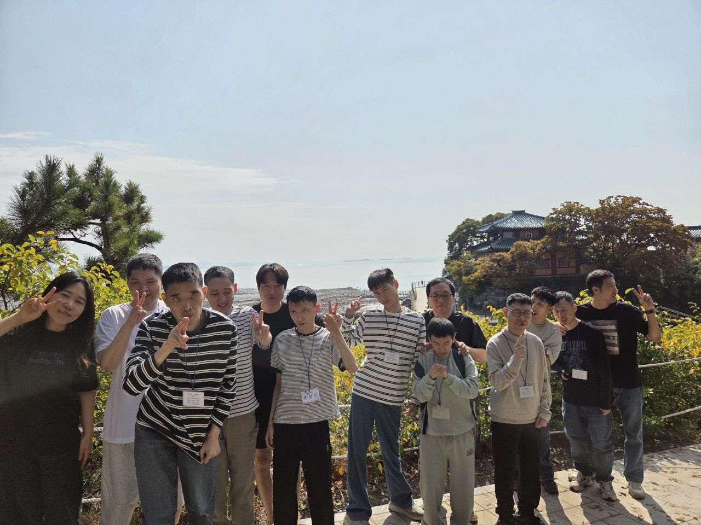
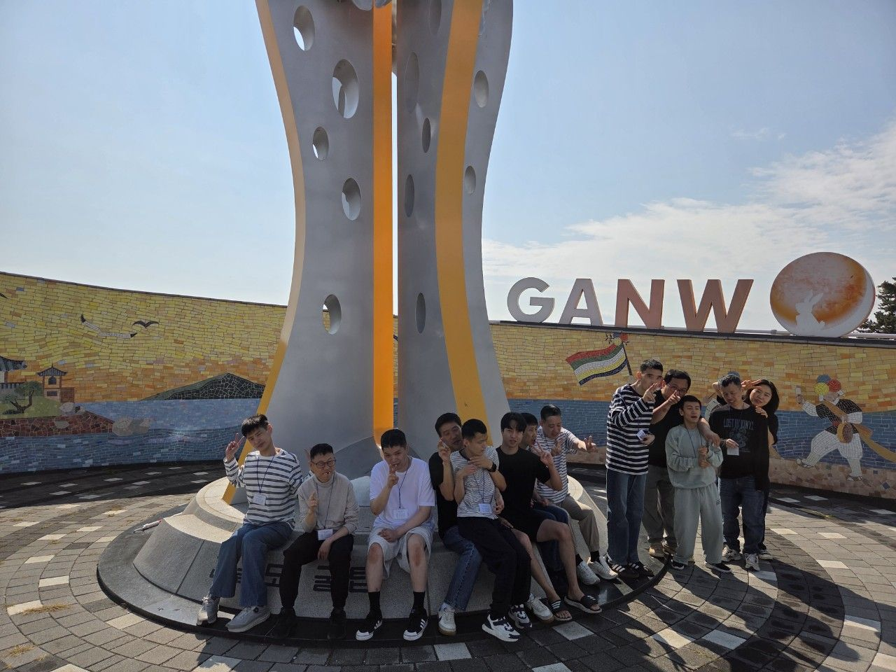
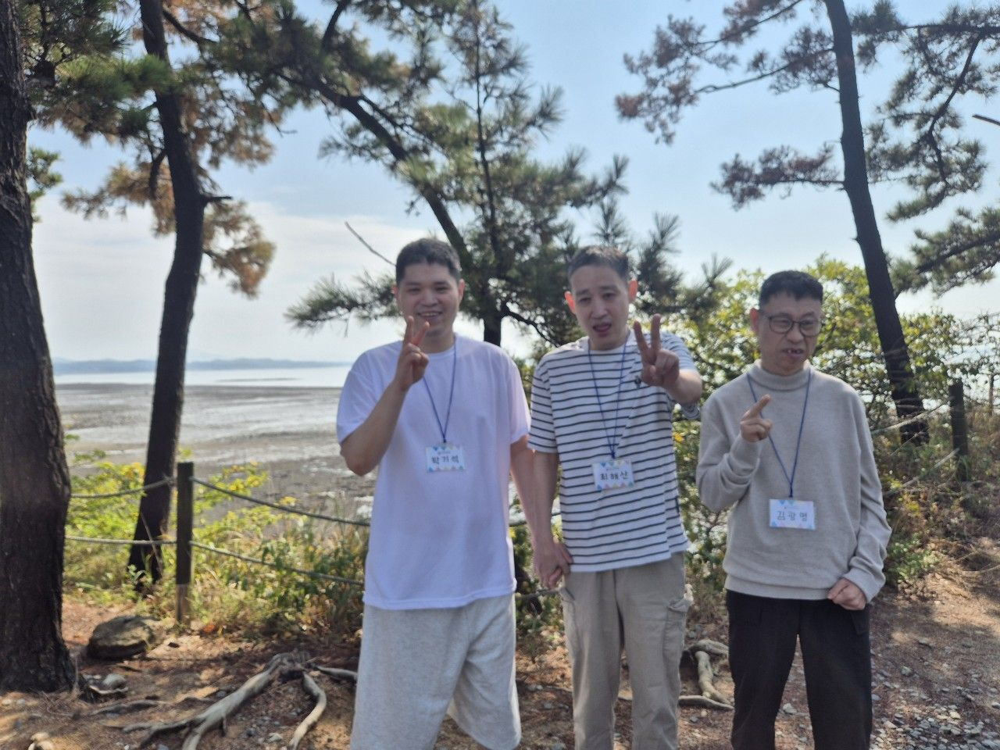
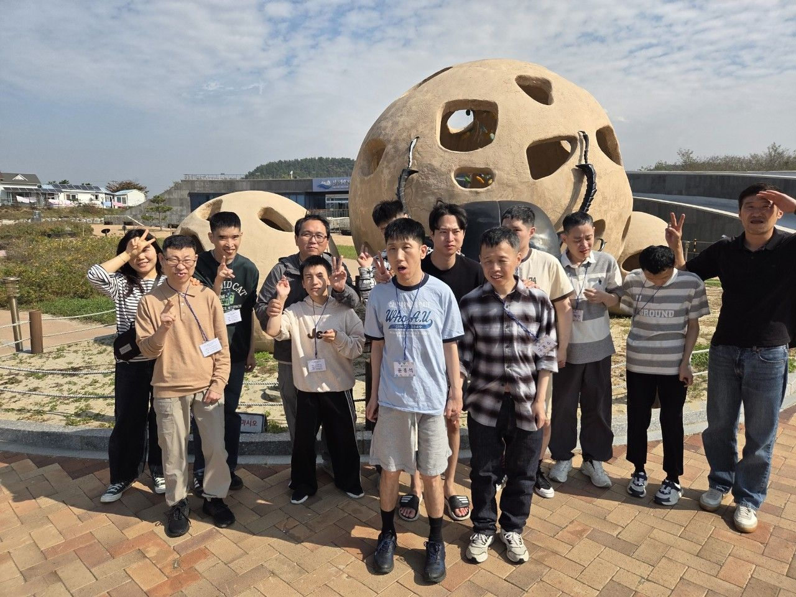
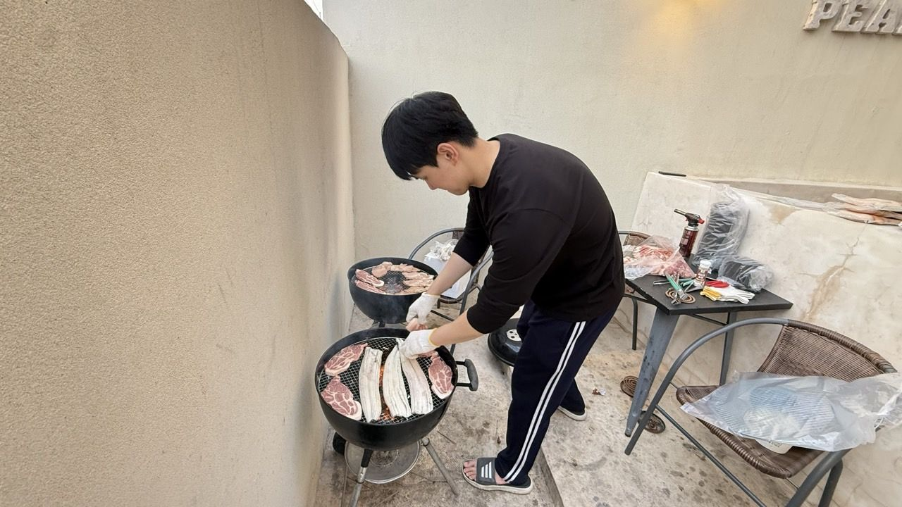

가을 여행으로 요나방과 모세방은 태안으로 가을 나들이를 다녀왔습니다.

1일차에는  신두리해안사구의 넓은 모래언덕 주변으로 바닷가 경치를 궁경하였고 저녁에는 푸짐한 숯불 바베큐를 준비하여 즐거운 시간을 보냈답니다. 

2일차에는 꽃게다리섬과 간월암에서 탁 트인 바다와 멋진 자연경관을 바라보며 일상에서 벗어나 여유로운 시간을 보냈습니다. 아름다운 풍경을 감상하고 함께 사진도 찍으며 즐거운 추억을 만들었습니다.

새로운 장소를 둘러보고 자연을 가까이에서 느끼며 이용자분들께 특별하고 행복한 시간이 되었답니다. ????

 

앞으로 도 이용자분들이 다양한 야외활동과 체험을 통해 즐거움을 느끼고, 소중한 추억을 많이 쌓으실 수 있도록 함께하겠습니다. ❤️

      

